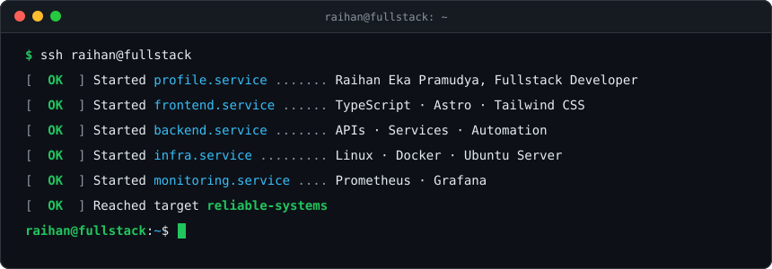

<div align="center">


<a href="https://github.com/qiau">
  
</a>

<br/>



<br/>


</div>


## `~/about`

```bash
raihan@fullstack:~$ neofetch --profile

  ┌──────────────────────────────────────────────────────────┐
  │  NAME       Raihan Eka Pramudya                          │
  │  ROLE       Fullstack Developer                          │
  │  FOCUS      Web applications · Automation · Reliability  │
  │  FRONTEND   TypeScript · Astro · Tailwind CSS            │
  │  BACKEND    APIs · Services · Automation scripts         │
  │  INFRA      Linux · Docker · Ubuntu Server               │
  │  OBSERVE    Prometheus · Grafana                         │
  │  WORKFLOW   Git · GitHub Actions · Code review           │
  │  STATUS     ● Open to collaboration                      │
  └──────────────────────────────────────────────────────────┘
```

I build web applications end to end, from the interface to the API to the server it runs on, and I care about keeping them simple, reliable, and easy to maintain. I like automating repetitive work, and I like being able to see how a system behaves once it is running.


## `~/stack`

<div align="center">

<!-- Add the backend tools you really use, e.g. nodejs, postgres, py. Icon IDs: https://github.com/tandpfun/skill-icons -->


</div>


## `~/principles`

```bash
raihan@fullstack:~$ cat principles.txt

  [1] Simple beats clever.
  [2] Consistency beats intensity.
  [3] If it can be automated, automate it.
  [4] If it can break, monitor it.
```


## `~/status`

<!-- Updated automatically every day by .github/workflows/update-status.yml. Do not edit between the markers. -->
<!--STATUS:START-->
```text
raihan@fullstack:~$ ./status.sh

  synced        2026-11-23 (UTC)
  uptime        3y 3m on GitHub
  public repos  24
  followers     21
  thought       Read the logs before guessing.
```
<!--STATUS:END-->


## `~/stats`

<div align="center">


<br/><br/>


<br/>


</div>


## `~/activity`

<div align="center">


<br/>

<picture>
  <source media="(prefers-color-scheme: dark)" srcset="https://raw.githubusercontent.com/qiau/qiau/output/github-snake-dark.svg" />
  <source media="(prefers-color-scheme: light)" srcset="https://raw.githubusercontent.com/qiau/qiau/output/github-snake.svg" />
  
</picture>

</div>


## `~/contact`

```bash
raihan@fullstack:~$ ./contact.sh

  → github    https://github.com/qiau
  → linkedin  https://www.linkedin.com/in/raihanep
  → email     raihanep28@gmail.com
  → web       https://raihanep.com
```

<div align="center">

<a href="https://github.com/qiau"></a>
<a href="https://www.linkedin.com/in/raihanep"></a>
<a href="mailto:raihanep28@gmail.com"></a>
<a href="https://raihanep.com"></a>

<br/><br/>


</div>
